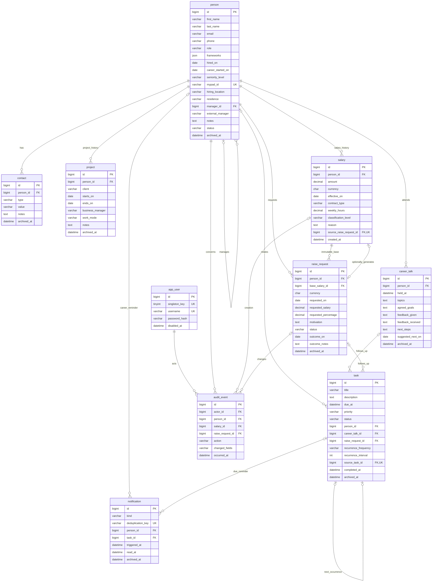

# ADR 0001 - dominio, struttura e schema MySQL

Stato: approvato al termine dello Step 1. Data: 2026-11-02.

## Contesto e decisioni

Monoutente, dati personali e finanziari, nessun requisito di sincronizzazione
distribuita. Monorepo con backend/ e frontend/, namespace Java `it.myri`.
Backend organizzato per dominio (`person`, `contact`, `salary`, `raiserequest`,
`careertalk`, `task`, `notification`, `audit`, `auth`), ciascuno con i layer
necessari controller/service/repository/dto/mapper. Nessuna classe vuota per
simulare un'implementazione prima dello Step 2.

PK **BIGINT AUTO_INCREMENT**: 8 byte, indice clustered compatto, mapping JPA
semplice, ordinamento stabile per risolvere parita. UUID BINARY(16) utile per
generazione distribuita e merge offline, qui non richiesti; aggiungerebbe
conversioni e indici piu grandi senza vantaggi funzionali. Gli ID non sono
un controllo di accesso; tutte le letture di dominio richiederanno login.

Tabelle/colonne minuscole snake_case, InnoDB, utf8mb4 e utf8mb4_0900_ai_ci.
Stati VARCHAR/CHECK, importi DECIMAL(12,2), percentuali DECIMAL(9,4), testi
lunghi TEXT. Codici valuta ISO 4217 uppercase di tre lettere: CHECK sul formato,
validazione dell'effettivo codice valuta nel service.

Tutti gli istanti DATETIME(6) con convenzione UTC; connessione
`serverTimezone=UTC`, server/sessione UTC. Le date civili sono DATE. Le colonne
updated_at/version sono gestite dall'applicazione (optimistic locking JPA);
non ci sono aggiornamenti timestamp impliciti del DB.

### Cancellazione e storico

Nessuna eliminazione fisica. Entita modificabili con archived_at, utente con
disabled_at, task anche cancellabili logicamente con stato cancelled.
Persona inactive indica uscita dal team, distinto dall'archiviazione della scheda.
Le letture ordinarie escluderanno archiviati, con filtro esplicito per includerli.
Tutte le FK usano ON DELETE RESTRICT e ON UPDATE RESTRICT, senza cascata.

RAL e audit sono append-only, protetti da trigger contro UPDATE/DELETE.
Le altre tabelle hanno trigger anti-DELETE. Non esiste DELETE pubblico distruttivo.
Anche i privilegi runtime escluderanno DELETE e DDL; salary/audit avranno solo
SELECT/INSERT. I trigger non proteggono da un amministratore con DROP/TRUNCATE:
non assegnare tali privilegi al runtime.

Correzione RAL: nuova voce con decorrenza e motivo obbligatori, preservando
l'originale in timeline. RAL corrente: massima effective_on <= data odierna
nel fuso applicativo; a parita, massimo id. Le voci future restano pianificate
e visibili, ma non anticipano la RAL corrente. Non esiste archiviazione di una
singola voce RAL; l'archiviazione persona conserva l'intero storico.

### Persona e manager

`hired_on` e la data di assunzione in azienda, mantenuta senza modificare i dati
esistenti. L'estensione autorizzata distingue `career_started_on`, inizio della
carriera lavorativa opzionale e non successivo all'assunzione. PersonView calcola
anni e mesi completi per entrambe nel fuso applicativo: `seniority` rimane il
nome API della durata aziendale per compatibilita, `careerDuration` e la durata
professionale. `seniority_level` e invece selezionato manualmente tra junior,
medior e senior. Il valore legacy eventualmente presente nella colonna
`seniority` non viene letto o aggiornato. `hiring_location` e `residence`
sono dati anagrafici della persona.
`frameworks` e un elenco libero (massimo 50 nomi, massimo 100 caratteri ciascuno),
memorizzato come array JSON e mostrato vicino al ruolo nella UI. Gli spazi esterni
sono rimossi e i duplicati sono rifiutati senza distinzione di maiuscole/minuscole.
I record preesistenti ricevono un array vuoto, senza inferire framework.

`mypad_id` e separato dalla PK auto-incrementale e univoco anche per gli
archiviati, con la collation case-insensitive dello schema. Formato:
1-100 lettere ASCII/numeri/underscore/trattino. Obbligatorio nei nuovi censimenti;
per gli esistenti puo restare null fino all'assegnazione, senza backfill fittizi.
Una volta assegnato non puo essere svuotato. Il lock singleton di creazione e
modifica serializza i controlli; un indice univoco protegge anche il DB.
La UI usa il valore per un link alla pagina dipendente MyPad, senza chiamate API
o sincronizzazione di dati verso servizi esterni.

Manager interno opzionale oppure external_manager testuale opzionale, mai entrambi.
Questi campi sono ora legacy: rimossi dalla UI, conservati nel DB e nelle API
senza migrazione distruttiva e senza conversioni automatiche in progetti.
Nessun auto-riporto (trigger) o ciclo diretto/indiretto (service).
I cambi manager dovranno serializzare la verifica del grafo, non usare solo
controlli ottimistici sui singoli nodi: un lock sulla riga app_user singleton,
poi verifica antenati e modifica nella stessa transazione evita cicli concorrenti.
L'archiviazione non elimina riferimenti storici.

### Progetti della persona

La tabella `project` registra cliente, date civili nullable `starts_on`/`ends_on`,
BM testuale, `work_mode` (`onsite|remote|hybrid`) e note. FK person_id con indice
e ON DELETE RESTRICT, versionamento ottimistico e archiviazione logica.
Le date sono inclusive; un limite assente e aperto, entrambi assenti indicano
un progetto attivo. Lo stato attivo/passato/futuro e derivato dal calendario
APP_TIMEZONE, mai memorizzato. Progetti sovrapposti sono ammessi.
L'export include anche i progetti archiviati nel limite complessivo di 1000 record.

### Richiesta aumento e RAL

- Stato: draft, submitted, approved, rejected, postponed.
- Almeno uno tra requested_salary e requested_percentage.
  Importo = **nuova RAL annua desiderata**, non incremento.
- Entrambi consentiti: verificare coerenza con la base immutabile referenziata.
  Formula: target = base * (1 + percentuale / 100), arrotondata a 2 decimali
  con HALF_UP. Se solo percentuale, calcolare target nel service.
- La RAL base e esplicita, della stessa persona/valuta e scelta tra le voci
  valide alla data richiesta. Target deve superare la base; controlli cross-table
  nel service, non esprimibili con un CHECK locale.
- Valuta della base, nessun cambio valutario implicito.
- Approvazione: creazione RAL opzionale con scelta esplicita e decorrenza
  obbligatoria se scelta. Niente approvazione silenziosamente materializzata.
- Un solo source_raise_request_id per voce generata e UNIQUE sulla sorgente:
  una richiesta puo generare al massimo una RAL. FK composita assicura
  stessa persona/valuta. La generazione richiede stato approved nel service.
- RAL, stato aumento e audit nella stessa transazione; lock della richiesta
  e optimistic version. Nessuna seconda creazione al retry.
- Conferma Step 2: richieste modificabili in draft e submitted, senza cambio
  implicito di stato; submitted puo passare ad approved/rejected/postponed.
  Postponed puo tornare in draft con esito azzerato. Approved/rejected definitivi:
  nuova trattativa richiede nuova richiesta. Archiviazione sempre logica.
  Persona/base/valuta non sono trasferibili a un'altra richiesta tramite PUT.
- outcome_on obbligatoria per gli stati con esito, non prima di requested_on.
  L'audit memorizza attore, azione, riferimenti e nomi dei campi, non payload
  o snapshot indiscriminati. Gli importi restano nello storico protetto.

### Task e ricorrenza

Task autonomi oppure legati a persona, career talk e/o richiesta contemporaneamente,
purche della stessa persona. Quando esiste talk/richiesta, person_id e obbligatorio:
FK composite garantiscono la coerenza anche con piu collegamenti.
L'API puo derivare person_id dai riferimenti, ma deve rifiutare contraddizioni.

Stati todo/in_progress/done/cancelled; priorita low/medium/high; due_at opzionale,
obbligatoria se ricorrente. completed_at presente se e solo se done.
Ricorrenza daily/weekly/monthly con intervallo intero positivo.
Al completamento crea una sola occorrenza successiva futura, saltando quelle perse;
source_task_id UNIQUE impedisce due successori dello stesso completamento.
Generazione e completamento nella stessa transazione. Nessuna generazione per
cancellazione o archiviazione. Il service deve vietare cicli nella catena.

Calcolo calendariale in Europe/Rome configurabile, poi conversione UTC. Ancorare
il giorno all'occorrenza originaria per evitare deriva mensile (31 gennaio ->
fine febbraio -> 31 marzo). Negli orari inesistenti per DST spostare avanti
del gap, negli ambigui usare l'offset precedente quando valido, altrimenti
il primo: comportamento java.time da coprire con test allo Step 4.

### Reminder e calendario

N iniziale 3 mesi configurabile, persone attive non archiviate. Per chi non ha
talk usare hired_on. Suggerire quando la data odierna e strettamente successiva
all'ultima data utile + N mesi; incontri futuri non sono incontri gia avvenuti.
La data suggerita e un'indicazione visibile, non sostituisce un incontro svolto.

Notifiche senza copie dei dati sensibili. Chiave UNIQUE di deduplicazione:
task:id:due_at per scadenze; career:person_id:last_talk_id (o hired_on se assente)
per assenza talk. Archiviare una notifica non rimuove la chiave e non la rigenera.
Una nuova data di scadenza o un nuovo incontro definisce un nuovo ciclo.
Conferma Step 4: il reminder task parte dall'inizio del giorno di scadenza
nel fuso applicativo e include task arretrati. Notifiche storiche conservate
anche se il task viene completato o si tiene un incontro; nessuna notifica
nuova per lo stesso ciclo letto/archiviato. Incontri archiviati esclusi dal
riferimento career talk.

Viste nel fuso applicativo: oggi [inizio oggi, inizio domani), scaduti prima
dell'istante corrente, prossimi 7 giorni [inizio domani, inizio oggi+8 giorni).
Escludere task done/cancelled/archiviati. Un task di oggi puo anche essere scaduto.
Timeline per data evento discendente, poi tipo e ID per ordinamento stabile:
effective_on RAL, requested_on aumento, held_at talk, due_at task o created_at
se senza scadenza. Esporre anche created_at e distinguere eventi futuri.

## ER

Le due sorgenti notification sono alternative; cosi anche i target dell'audit.
ER omette i campi tecnici comuni created_at/updated_at/version dove ripetitivi:
le definizioni complete sono nelle migrazioni. Salary/audit non hanno version
mutabile; notification usa read_at/archived_at, non updated_at.

## Migrazioni, privilegi e rischi

- V1 crea lo schema completo (tabelle, colonne, indici, CHECK e FK) e risolve
  la dipendenza circolare salary/raise_request aggiungendo la FK della sorgente
  dopo le due CREATE TABLE. Tutte le estensioni sviluppate prima del rilascio
  sono consolidate in questa migrazione iniziale.
- V2 installa tutti i trigger append-only, anti-delete e anti-auto-riporto,
  inclusa la protezione della tabella project.
- La cronologia incrementale V3-V14 usata durante lo sviluppo e stata rimossa
  prima del primo rilascio. Database che l'hanno gia applicata vanno ricreati
  soltanto se sono ambienti dev sacrificabili; non e previsto un upgrade da
  quella cronologia consolidata.
- Flyway con flyway-mysql; Hibernate ddl-auto=validate attivo nello Step 2.
- Harness con Spring Boot parent 3.5.16 e Java 21. Flyway 11.20.3 fissato
  esplicitamente per supportare MySQL 8.4 senza l'avviso del ramo 10
  gestito dal parent. Versioni verificate su Maven Central; niente Boot 4
  introdotto implicitamente contro lo stack richiesto.
- MySQL non rende atomico un intero file DDL. Su DB nuovo fallito, ricreare solo
  lo schema di sviluppo dedicato; su installato usare procedura di recovery,
  non un flyway repair automatico o cancellazione di dati.
- Account migrazioni: DDL/trigger limitato allo schema; niente utenza root runtime.
  Con binary log abilitato, configurare log_bin_trust_function_creators=1 sul
  server amministrato per consentire trigger alla utenza migrazioni senza SUPER.
  L'account runtime non avra CREATE/TRIGGER/DROP/ALTER/DELETE.
- I test impostano charset/collation/UTC e questa opzione nel MySQL effimero;
  non contengono credenziali reali o seed di produzione.
- Gli indici univoci compositi person_id/id sono intenzionalmente ridondanti
  rispetto alla PK per supportare FK composite standard anche su MySQL 8.4,
  senza dipendere da chiavi referenziate non univoche.

Verifiche Step 1: inizializzazione, validazione/no-op Flyway, tipi, charset,
indici, FK, valori/stati non validi, immutabilita, archiviazione, unicita account,
coerenza task, deduplicazione e unicita RAL generata.
I test service per regole cross-row e concorrenza appartengono agli Step 2/4:
lo schema da solo non garantisce assenza di cicli, coerenza percentuale/base,
macchina a stati, autorizzazioni o completezza dell'audit transazionale.

Step 2: tali regole sono ora verificate nei service e nei test API/concorrenza.
La parte transazionale della ricorrenza e stata implementata insieme al comando
complete, per non introdurre un completamento parziale da cambiare allo Step 4.
Scheduler, dashboard e suggerimenti automatici restano nello Step 4.
Per timeline date-only, sortAt normalizza la data alla mezzanotte UTC solo per
l'ordinamento; eventDate conserva la data civile senza fingere un'ora reale.
