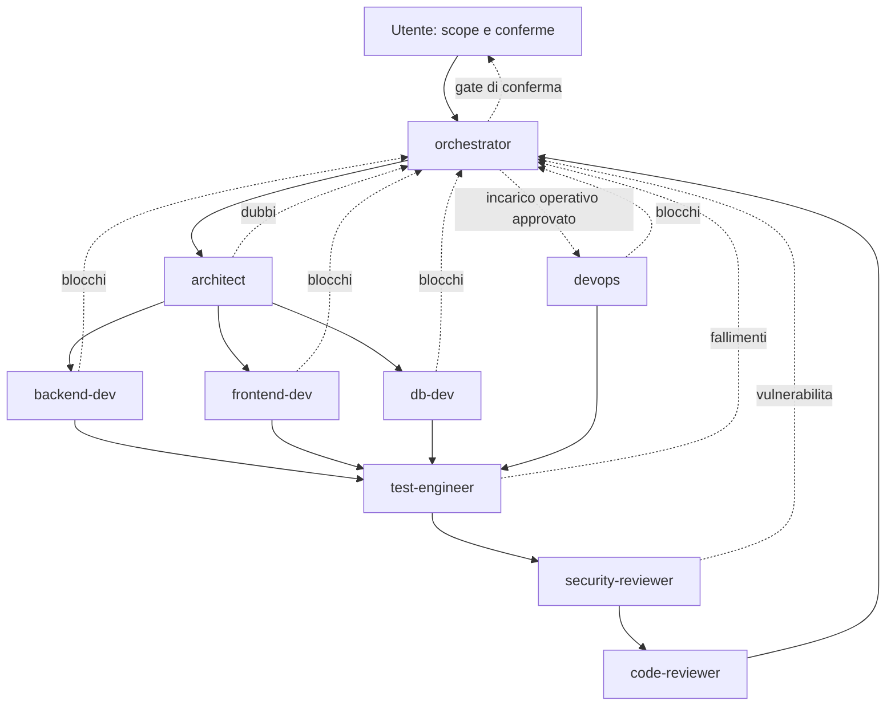

# Workspace multi-agente

## Compatibilita verificata

Documentazione ufficiale consultata il 2026-11-02:

- [Custom agents](https://code.visualstudio.com/docs/agent-customization/custom-agents)
- [Frontmatter e tools](https://code.visualstudio.com/docs/agents/reference/custom-agent-file-reference)
- [Subagents](https://code.visualstudio.com/docs/agents/run/subagents)
- [Tools reference](https://code.visualstudio.com/docs/agents/reference/tools-reference)
- [Prompt files](https://code.visualstudio.com/docs/agent-customization/prompt-files)
- [Custom instructions](https://code.visualstudio.com/docs/agent-customization/custom-instructions)

Questi file hanno `target: vscode`: sono progettati per **Local harness in VS Code**,
con GitHub Copilot disponibile. Se il selettore Session Target e presente, scegliere
Local. `target` guida lo schema dell'editor: NON cambia l'harness della sessione.
Non e una configurazione del cloud coding agent.

Differenze importanti rispetto a configurazioni precedenti o altri client:

| Aspetto | Configurazione e limite attuali |
| --- | --- |
| Agenti | `.github/agents/*.agent.md`, non i vecchi `.chatmode.md` |
| Frontmatter | `name`, `description`, `tools`, `target`, `agents`, `handoffs`; `model` omesso intenzionalmente |
| Delega | `agents` limita i nomi case-sensitive; richiede `agent` in tools |
| Handoff | `label`, `agent`, `prompt`, `send: false`; transizione manuale Local |
| Harness Copilot nativo | Non supporta i campi Local `agents` e `handoffs`; delega nativa tramite task, non `agent/runSubagent` |
| Prompt | `.prompt.md` e slash command qui destinati a Local; per Copilot nativo servono workflow/skill compatibili |
| Strumenti | Alias integrati `read`, `search`, `edit`, `execute`, `agent`; non tool set personalizzati deprecati |
| Tool qualificati | Local espone per esempio `read/readFile`, `search/changes`, `execute/runInTerminal`, `agent/runSubagent`; non sono nomi portabili per ogni harness |
| Visibilita | `user-invocable` e `disable-model-invocation` sostituiscono il deprecato `infer`; qui si usano i default |
| Impostazioni | Discovery nelle directory standard; non aggiunti vecchi flag sperimentali per abilitare custom agents |

Gli alias read/search/edit sono mostrati anche negli esempi ufficiali Local.
Gli strumenti effettivi dipendono da versione, estensioni, policy e harness:
un tool non disponibile puo essere ignorato. Verificare **Configure Tools** e
Chat **Diagnostics**; l'assenza di errori durante discovery non prova l'esecuzione.
Non e stata verificata in questa consegna una sessione VS Code interattiva.

## Flusso

Le frecce piene sono handoff manuali salvo ingresso dell'utente; la freccia verso
devops indica una delega esplicita dell'orchestrator nello scope approvato.
Un handoff cambia agente nella conversazione; un subagent lavora in un contesto
separato. Non sono una pipeline automatica e non sostituiscono il consenso.

## Ruoli e privilegi

| Agente | Quando usarlo | Strumenti / scritture ammesse |
| --- | --- | --- |
| orchestrator | Richiesta, piano, dipendenze, blocchi | read/search/edit/agent; solo docs/plan.md |
| architect | ER, API, invarianti, ADR | read/search/edit; solo docs/adr/, codice read-only |
| backend-dev | Spring, API, sicurezza, scheduler | read/search/edit/execute; backend autorizzato |
| frontend-dev | Angular, Material, client API | read/search/edit/execute; frontend autorizzato |
| db-dev | Schema, migrazioni, indici, seed dev | read/search/edit/execute; schema e seed autorizzati |
| test-engineer | Unit, Testcontainers, UI/e2e | read/search/edit/execute; test/fixture/config test |
| security-reviewer | Analisi statica sicurezza | solo read/search; report in chat |
| devops | Container, nginx, backup, README | read/search/edit/execute; file operativi autorizzati |
| code-reviewer | Review finale di correttezza | solo read/search; report in chat |

I limiti per percorso di architect e orchestrator sono istruzioni, non ACL:
edit puo tecnicamente modificare altri file. Controllare sempre diff e richieste
strumenti; per isolamento forte usare worktree/ambienti separati e policy esterne.
I reviewer non ricevono edit, execute, agent o web. I report non vengono salvati
da loro: se serve un file, assegnarne la persistenza a un agente autorizzato.
Nessun agente ha tool web/MCP non necessari o modello vincolato a un abbonamento.

## Avvio in VS Code

1. Aprire la radice del repository, valutare Workspace Trust solo per codice fidato
   e installare le estensioni consigliate; autenticarsi a GitHub Copilot.
2. Usare una versione stabile aggiornata di VS Code; selezionare Local se previsto
   dalla UI. In Chat: Open Customizations verificare nove agenti e quattro prompt.
3. Verificare caricamento di copilot-instructions.md, AGENTS.md e istruzioni mirate
   in Diagnostics. In Configure Tools controllare Run Subagent per orchestrator.
4. Scegliere orchestrator e usare `/new-feature` con la richiesta. Il planner
   aggiorna solo il piano; confermare esplicitamente prima dell'implementazione.
5. Usare gli handoff, rileggere il prompt precompilato e inviarlo manualmente.
   Controllare scope, diff e risultati prima del passaggio successivo.

`.vscode/settings.json` abilita istruzioni condivise e AGENTS.md; disabilita
deleghe annidate e routing Auto aggiuntivo dei subagent. Non disabilita approvazioni,
non forza modelli e non configura segreti. Non serve un flag generale per abilitare
i subagent: occorrono il tool agent e l'elenco agents del coordinatore.

## Prompt disponibili

| Prompt | Agente | Risultato |
| --- | --- | --- |
| `/new-feature` | orchestrator | Piano incrementale e consenso prima del codice |
| `/add-entity` | orchestrator | Piano end-to-end migrazione/JPA/API/UI/test, poi handoff |
| `/review-security` | security-reviewer | Report statico read-only |
| `/prepare-release` | orchestrator | Checklist, incarichi approvati ed evidenze go/no-go |

I prompt non definiscono tools: ereditano quelli dell'agente. Questo evita che
la precedenza dei tools del prompt allarghi i privilegi dei reviewer.

## Deleghe e integrazione

Solo orchestrator ha agent; gli altri dichiarano agents vuoto e non delegano.
Le deleghe devono includere obiettivo, step autorizzato, contesto/ADR, file posseduti,
azioni ammesse, output, criteri di accettazione e condizione di stop.
Nessuna delega implementativa prima dei gate. Non scrivere sullo stesso file
da due agenti; sequenziare migrazioni/manifest e usare un solo integratore.
I subagent Local non ereditano tutta la cronologia e sono stateless:
includere sempre il contesto completo rilevante nell'incarico.
I test in MySQL richiedono Docker; un blocco ambientale va riportato, non aggirato
con H2. Commit e push non sono responsabilita dei subagent.

## Aggiungere un agente

Creare `.github/agents/<nome>.agent.md` con nome univoco, description, target vscode,
tools minimi, agents vuoto salvo coordinamento motivato e handoff con send false.
Definire ruolo, ownership, limiti, stop e output; usare reviewer read-only.
Aggiornare elenco agents del coordinatore solo se la delega serve davvero,
diagramma, tabella e prompt interessati. Verificare frontmatter, destinazioni,
istruzioni, strumenti effettivi e una prova manuale in Local senza dati reali.
Rivalutare la documentazione ufficiale prima di introdurre nuovi campi o tools.
