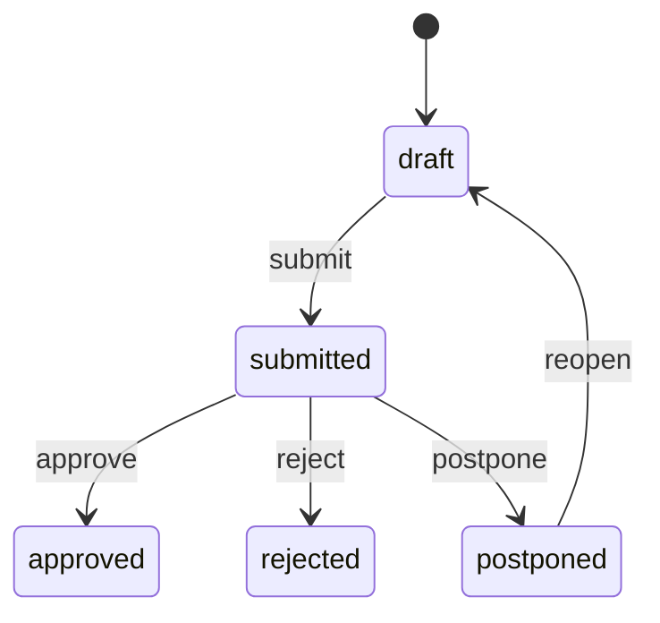

# Backend REST - Step 2

Implementato sotto `/api/v1` con sessione Spring Security. Backend e DB non
pubblicano porte host: la UI/nginx dello Step 3 inoltra le API same-origin.
I test HTTP
integrati usano MockMvc con login reale, JPA e Testcontainers MySQL.

## Login e CSRF

1. `GET /api/v1/auth/csrf`, conservando il cookie di sessione: risposta con
   `headerName`, `parameterName`, `token`.
2. `POST /api/v1/auth/login` con content type `application/x-www-form-urlencoded`,
   campi `username` e `password` e il token nell'header indicato. Successo 204,
   credenziali errate 401, CSRF assente/non valido 403.
3. La sessione ruota al login. Recuperare un nuovo token CSRF con GET e inviarlo
   in ogni POST/PUT; il cookie HttpOnly va gestito dal browser, non da localStorage.
4. `GET /api/v1/auth/me` restituisce solo ID e username.
5. `POST /api/v1/auth/logout` con CSRF invalida la sessione, risponde 204 ed elimina
   il cookie. Per un nuovo login recuperare nuovamente CSRF.

Nessuna registrazione, autenticazione Basic o JWT. Sessione inattiva 30 minuti.
Le credenziali sono BCrypt strength 12. Il principal di sessione non conserva
l'hash dopo login. Reset password cambia la versione credenziali: una sessione
precedente viene invalidata alla successiva richiesta, anche su altro processo
backend connesso allo stesso DB.

`/health` espone soltanto `{"status":"UP"}`. OpenAPI `/v3/api-docs` e
`/swagger-ui/index.html` richiedono login; login/logout sono documentati anche
se gestiti dai filtri Security. Nessun endpoint di debug con dati applicativi.
Keycloak/OIDC rimane un'opzione futura, non un provider fittizio gia attivo.

## Formati e concorrenza

- ID e versioni Long: stringhe decimali JSON. Importi/percentuali: stringhe
  decimali, senza floating point. Metadati paginazione sono numerici.
- Date civili `YYYY-MM-DD`; istanti ISO 8601 UTC. Intervallo calendario
  supportato MySQL: anni 1000-9999. Il fuso applicativo e Europe/Rome configurabile.
- Bean Validation e rifiuto campi JSON sconosciuti. ID interi, non float troncati.
  Errori in `application/problem+json`, senza valori rifiutati, SQL o stack trace.
- Liste con `page=0`, `size=20` (1-100), sort su whitelist (`campo,asc|desc`).
  Risposta `{items,page,size,totalElements,totalPages}`.
- `q` fino a 200 caratteri, ricerca case-insensitive con wildcard utente trattate
  letteralmente. Filtri di stato e date validati; intervalli `[from,to)`.
- Aggiornamenti PUT richiedono la versione corrente nel body. Comandi semplici
  ricevono `{"version":"0"}`. Versione obsoleta 409. Dopo una scrittura usare la
  nuova versione restituita. L'update persona serializza il controllo del grafo manager.
- `includeArchived=false` sulle liste. GET per ID rimane disponibile per
  consultazione storica; modifiche su risorse archiviate rifiutate.
- Non esiste eliminazione fisica. POST archive imposta archivedAt; nessun
  restore/unarchive pubblico in questo step. Nessun endpoint PUT/DELETE di RAL o audit.

## Risorse

| Percorso relativo a /api/v1 | Operazioni | Ricerca e filtri |
| --- | --- | --- |
| people | GET, POST | q su nome/cognome/email/ruolo, status, managerId |
| people/{id} | GET, PUT | DTO PersonInput/PersonView |
| people/{id}/archive | POST | version |
| people/{id}/contacts | GET, POST | q su tipo/valore, type |
| contacts/{id} | GET, PUT | persona non trasferibile |
| contacts/{id}/archive | POST | version |
| people/{id}/salaries | GET, POST | q su motivo, currency, from/to per decorrenza |
| raise-requests | GET, POST | q su motivazione, personId, status |
| raise-requests/{id} | GET, PUT | modifica solo draft/submitted |
| raise-requests/{id}/submit, reopen, archive | POST | version |
| raise-requests/{id}/approve | POST | esito e creazione RAL esplicita |
| raise-requests/{id}/reject, postpone | POST | version, outcomeOn, outcomeNotes |
| career-talks | GET, POST | q su argomenti/obiettivi, personId, from/to |
| career-talks/{id} | GET, PUT | persona non trasferibile |
| career-talks/{id}/archive | POST | version |
| tasks | GET, POST | q su titolo/descrizione, personId, status, priority, from/to |
| tasks/{id} | GET, PUT | PUT per task aperti, stati todo/in_progress |
| tasks/{id}/complete, cancel, archive | POST | version |
| people/{id}/timeline | GET | kinds, includeArchived, page/size |
| notifications | GET | kind, unreadOnly, includeArchived, page/size |
| notifications/{id}/read, archive | POST | version |
| audit | GET | personId, salaryId, requestId, from/to, page/size |

DTO completi, vincoli e codici risposta in OpenAPI. Input di creazione non accetta
ID, timestamp tecnici, archivedAt o stato esito imposto dal client.
I mapper espliciti sono in PersonMapper e nei metodi view/apply dei DTO degli altri
domini; le entity non sono restituite dalle API e non hanno relazioni lazy serializzate.

### RAL e audit

POST salaries richiede amount, currency ISO 4217, effectiveOn, reason e
`requestKey` (1-100 lettere ASCII/numeri/underscore/trattino, consigliato UUID).
Ripetere la stessa chiave e payload restituisce la stessa voce, senza audit
duplicato; chiave riutilizzata con payload diverso produce 409. La chiave e
unica nell'intero database e usa la collation case-insensitive MySQL.
Le voci storiche precedenti a V3 non richiedono retroattivamente una chiave.

RAL mai sovrascritta; una correzione crea una nuova voce motivata.
Creazione RAL e relativo audit sono una sola transazione. Runtime ha SELECT/INSERT
su salary/audit_event, non UPDATE/DELETE. Audit riporta attore, riferimenti,
azione, campi modificati e istante: non replica note, motivazioni o importi nei log.

### Richieste

Creazione in draft con personId, baseSalaryId, requestedOn, almeno uno tra
requestedSalary (RAL target) e requestedPercentage, motivation.
Persona e base non trasferibili tramite PUT. Base della stessa persona, valida
alla data richiesta; valuta derivata dalla base. Se entrambi valorizzati,
`base * (1 + percentuale/100)` arrotondato HALF_UP a due decimali deve coincidere
con la RAL target. Il target deve superare la base e rientrare in DECIMAL(12,2).

PUT consentito in draft/submitted, incluso dopo invio senza cambio di stato.
Approved/rejected definitivi. L'archiviazione conserva ogni esito.
Reopen azzera outcomeOn/outcomeNotes. Modifiche e transizioni scrivono audit;
PUT identico non cambia versione e non produce un audit artificiale.

Approve riceve version, outcomeOn, outcomeNotes opzionali, createSalary boolean
obbligatorio e effectiveOn se e solo se createSalary=true.
Nessuna approvazione implicita crea RAL. Lock della richiesta, esito, eventuale
RAL e audit sono atomici. Retry di approvazione gia registrata con lo stesso
payload restituisce l'esito anche con la vecchia versione; payload differente
produce 409. Una richiesta genera al massimo una RAL. Esito non precedente
alla data richiesta; una nuova trattativa su un esito definitivo crea nuova richiesta.

### Task e timeline

Task autonomi oppure persona/careerTalkId/raiseRequestId, anche tutti insieme,
ma riferiti alla stessa persona. Se omesso, personId viene derivato dai riferimenti.
PUT non puo modificare task done/cancelled; usare complete/cancel per chiuderli
e archive per escluderli dalle viste ordinarie.

Completamento restituisce `{task,nextOccurrence}` ed e sicuro ai retry.
La parte transazionale della ricorrenza e implementata insieme al completamento,
senza attendere scheduler: frequenza daily/weekly/monthly, intervallo positivo,
dueAt obbligatorio; prossimo evento futuro, scadenze perse saltate, nessuna deriva
del giorno mensile. L'ancora calendario resta la prima occorrenza della catena;
la scadenza corrente e il limite minimo per calcolare la successiva.
Nessun successore per cancel/archive. I test coprono fine mese, DST e concorrenza.

Timeline unifica salary/raise_request/career_talk/task, ordinata per sortAt
discendente, tipo e ID. `kinds` accetta tipi separati da virgola.
Gli eventi date-only espongono eventDate; sortAt e normalizzato alla mezzanotte
UTC **solo per ordinamento**, non rappresenta un'ora reale dell'evento.
Le API di dettaglio conservano la data civile. Voci future non sono escluse.

Le API notifiche permettono lettura e archiviazione; la generazione scheduler
e i suggerimenti automatici sono riservati allo Step 4, come dashboard ed export.
