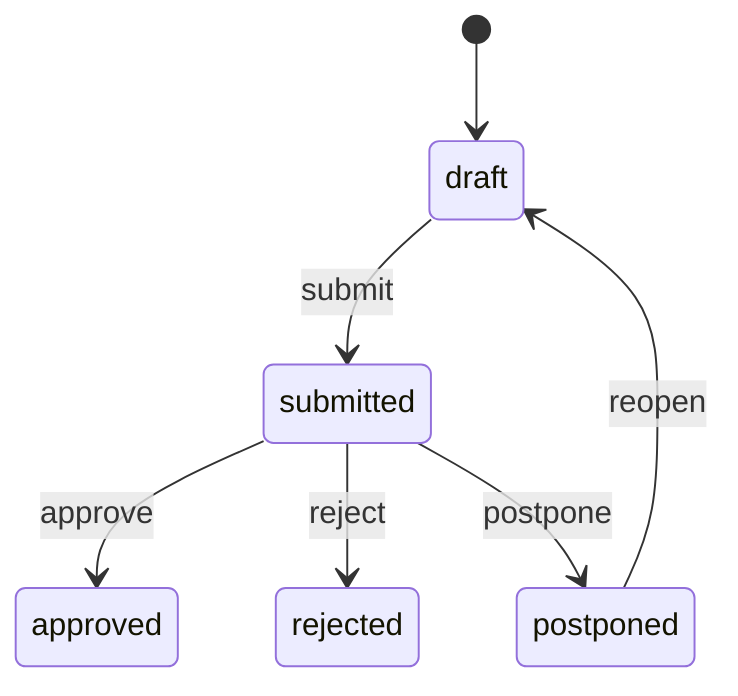

# Backend REST - Step 2 e Step 4

Implementato sotto `/api/v1` con sessione Spring Security. Backend e DB non
pubblicano porte host: la UI/nginx dello Step 3 inoltra le API same-origin.
I test HTTP
integrati usano MockMvc con login reale, JPA e Testcontainers MySQL.

## Login e CSRF

1. `GET /api/v1/auth/csrf`, conservando il cookie di sessione: risposta con
   `headerName`, `parameterName`, `token`.
2. `POST /api/v1/auth/login` con content type `application/x-www-form-urlencoded`,
   campi `username` e `password` e il token nell'header indicato. Successo 204,
   credenziali errate 401, CSRF assente/non valido 403.
3. La sessione ruota al login. Recuperare un nuovo token CSRF con GET e inviarlo
   in ogni POST/PUT; il cookie HttpOnly va gestito dal browser, non da localStorage.
4. `GET /api/v1/auth/me` restituisce solo ID e username.
5. `POST /api/v1/auth/logout` con CSRF invalida la sessione, risponde 204 ed elimina
   il cookie. Per un nuovo login recuperare nuovamente CSRF.

Nessuna registrazione, autenticazione Basic o JWT. Sessione inattiva 30 minuti.
Le credenziali sono BCrypt strength 12. Il principal di sessione non conserva
l'hash dopo login. Reset password cambia la versione credenziali: una sessione
precedente viene invalidata alla successiva richiesta, anche su altro processo
backend connesso allo stesso DB.

`/health` espone soltanto `{"status":"UP"}`. OpenAPI `/v3/api-docs` e
`/swagger-ui/index.html` richiedono login; login/logout sono documentati anche
se gestiti dai filtri Security. Nessun endpoint di debug con dati applicativi.
Keycloak/OIDC rimane un'opzione futura, non un provider fittizio gia attivo.

## Formati e concorrenza

- ID e versioni Long: stringhe decimali JSON. Importi/percentuali: stringhe
  decimali, senza floating point. Metadati paginazione sono numerici.
- Date civili `YYYY-MM-DD`; istanti ISO 8601 UTC. Intervallo calendario
  supportato MySQL: anni 1000-9999. Il fuso applicativo e Europe/Rome configurabile.
- Bean Validation e rifiuto campi JSON sconosciuti. ID interi, non float troncati.
  Errori in `application/problem+json`, senza valori rifiutati, SQL o stack trace.
- Liste con `page=0`, `size=20` (1-100), sort su whitelist (`campo,asc|desc`).
  Risposta `{items,page,size,totalElements,totalPages}`.
- `q` fino a 200 caratteri, ricerca case-insensitive con wildcard utente trattate
  letteralmente. Filtri di stato e date validati; intervalli `[from,to)`.
- Aggiornamenti PUT richiedono la versione corrente nel body. Comandi semplici
  ricevono `{"version":"0"}`. Versione obsoleta 409. Dopo una scrittura usare la
  nuova versione restituita. L'update persona serializza il controllo del grafo manager.
- `includeArchived=false` sulle liste. GET per ID rimane disponibile per
  consultazione storica; modifiche su risorse archiviate rifiutate.
- Non esiste eliminazione fisica. POST archive imposta archivedAt; nessun
  restore/unarchive pubblico in questo step. Nessun endpoint PUT/DELETE di RAL o audit.

## Risorse

| Percorso relativo a /api/v1 | Operazioni | Ricerca e filtri |
| --- | --- | --- |
| people | GET, POST | q su nome/cognome/email/ruolo, status, managerId |
| people/{id} | GET, PUT | DTO PersonInput/PersonView |
| people/{id}/archive | POST | version |
| people/{id}/contacts | GET, POST | q su tipo/valore, type |
| contacts/{id} | GET, PUT | persona non trasferibile |
| contacts/{id}/archive | POST | version |
| people/{id}/salaries | GET, POST | q su motivo, currency, from/to per decorrenza |
| raise-requests | GET, POST | q su motivazione, personId, status |
| raise-requests/{id} | GET, PUT | modifica solo draft/submitted |
| raise-requests/{id}/submit, reopen, archive | POST | version |
| raise-requests/{id}/approve | POST | esito e creazione RAL esplicita |
| raise-requests/{id}/reject, postpone | POST | version, outcomeOn, outcomeNotes |
| career-talks | GET, POST | q su argomenti/obiettivi, personId, from/to |
| career-talks/{id} | GET, PUT | persona non trasferibile |
| career-talks/{id}/archive | POST | version |
| tasks | GET, POST | q su titolo/descrizione, personId, status, priority, from/to |
| tasks/{id} | GET, PUT | PUT per task aperti, stati todo/in_progress |
| tasks/{id}/complete, cancel, archive | POST | version |
| people/{id}/timeline | GET | kinds, includeArchived, page/size |
| notifications | GET | kind, unreadOnly, includeArchived, page/size |
| notifications/{id}/read, archive | POST | version |
| audit | GET | personId, salaryId, requestId, from/to, page/size |
| todos | GET | view=today/overdue/next7/all, personId, page/size |
| dashboard | GET | riepilogo al medesimo istante asOf |
| dashboard/career-due | GET | page/size, persone attive oltre soglia |
| people/{id}/salary-trend | GET | page/size, decorrenza ascendente, poi ID |
| people/{id}/export | GET | format=json/csv (default json), attachment no-store |

DTO completi, vincoli e codici risposta in OpenAPI. Input di creazione non accetta
ID, timestamp tecnici, archivedAt o stato esito imposto dal client.
I mapper espliciti sono in PersonMapper e nei metodi view/apply dei DTO degli altri
domini; le entity non sono restituite dalle API e non hanno relazioni lazy serializzate.

PersonInput richiede `hiredOn` (data di assunzione in azienda) e accetta
`careerStartedOn` (inizio della carriera lavorativa, non successivo all'assunzione),
`seniorityLevel` (`junior|medior|senior`, selezione manuale), `hiringLocation`
(sede di assunzione, massimo 200 caratteri), `residence` (residenza, massimo 500)
e `frameworks`, elenco facoltativo di massimo 50 nomi (1-100 caratteri ciascuno).
I nomi vengono salvati senza spazi esterni e non possono ripetersi senza distinzione
tra maiuscole e minuscole. In PUT, `frameworks` omesso conserva l'elenco esistente;
un elenco vuoto lo cancella. PersonView restituisce sempre un array, anche vuoto.
La UI usa una riga per framework; JSON mantiene l'array e il CSV lo serializza
come testo separato da virgole in una singola cella.
`mypadId` e un identificativo esterno separato dall'ID tecnico auto-generato:
1-100 lettere ASCII, numeri, underscore o trattini, univoco anche tra persone
archiviate (confronto secondo la collation case-insensitive del DB).
Obbligatorio su POST; su PUT puo restare null soltanto per persone legacy che
non lo hanno ancora. Una volta assegnato non puo essere svuotato.
Creazione e modifica serializzano anche il controllo di unicita; il DB lo
garantisce con un indice univoco. Duplicati restituiscono 409, dati non validi 400.

PersonView mantiene `seniority` per compatibilita come durata dall'assunzione e
aggiunge `careerDuration` come durata dall'inizio carriera: anni e mesi completi
calcolati alla data corrente nel fuso applicativo, non editabili ne persistiti.
Date future producono `data futura`; una data inizio carriera assente produce
durata null. La seniority professionale manuale e invece `seniorityLevel`.
La migrazione V6 non inventa date, livelli o ID per i record esistenti: i nuovi
campi restano null, `hiredOn` resta invariata. L'eventuale colonna legacy
`seniority` resta nel database senza essere letta o aggiornata.
JSON/CSV includono i nuovi campi. Reminder e soglie aziendali continuano a usare
la data di assunzione, non quella di inizio carriera.

### RAL e audit

POST salaries richiede amount, currency ISO 4217, effectiveOn, reason e
`requestKey` (1-100 lettere ASCII/numeri/underscore/trattino, consigliato UUID),
oltre a `contractType`, `weeklyHours` (da 0.01 a 168, massimo due decimali) e
`classificationLevel`. Questi tre campi sono inclusi in ogni voce e nel relativo
storico immutabile. Una RAL creata approvando un aumento eredita i dati dalla
RAL base. Se la RAL base e precedente alla V5, i dati contrattuali non disponibili
restano nulli anche nella voce generata; non vengono inventati valori.
Le voci precedenti alla migrazione V5 mantengono questi campi nulli, perche non
e possibile ricostruire retroattivamente dati mancanti.
Ripetere la stessa chiave e payload restituisce la stessa voce, senza audit
duplicato; chiave riutilizzata con payload diverso produce 409. La chiave e
unica nell'intero database e usa la collation case-insensitive MySQL.
Le voci storiche precedenti a V3 non richiedono retroattivamente una chiave.

RAL mai sovrascritta; una correzione crea una nuova voce motivata.
Creazione RAL e relativo audit sono una sola transazione. Runtime ha SELECT/INSERT
su salary/audit_event, non UPDATE/DELETE. Audit riporta attore, riferimenti,
azione, campi modificati e istante: non replica note, motivazioni o importi nei log.

### Richieste

Creazione in draft con personId, baseSalaryId, requestedOn, almeno uno tra
requestedSalary (RAL target) e requestedPercentage, motivation.
Persona e base non trasferibili tramite PUT. Base della stessa persona, valida
alla data richiesta; valuta derivata dalla base. Se entrambi valorizzati,
`base * (1 + percentuale/100)` arrotondato HALF_UP a due decimali deve coincidere
con la RAL target. Il target deve superare la base e rientrare in DECIMAL(12,2).

PUT consentito in draft/submitted, incluso dopo invio senza cambio di stato.
Approved/rejected definitivi. L'archiviazione conserva ogni esito.
Reopen azzera outcomeOn/outcomeNotes. Modifiche e transizioni scrivono audit;
PUT identico non cambia versione e non produce un audit artificiale.

Approve riceve version, outcomeOn, outcomeNotes opzionali, createSalary boolean
obbligatorio e effectiveOn se e solo se createSalary=true.
Nessuna approvazione implicita crea RAL. Lock della richiesta, esito, eventuale
RAL e audit sono atomici. Retry di approvazione gia registrata con lo stesso
payload restituisce l'esito anche con la vecchia versione e dopo archiviazione;
payload differente
produce 409. Una richiesta genera al massimo una RAL. Esito non precedente
alla data richiesta; una nuova trattativa su un esito definitivo crea nuova richiesta.

### Task e timeline

Task autonomi oppure persona/careerTalkId/raiseRequestId, anche tutti insieme,
ma riferiti alla stessa persona. Se omesso, personId viene derivato dai riferimenti.
PUT non puo modificare task done/cancelled; usare complete/cancel per chiuderli
e archive per escluderli dalle viste ordinarie.

Completamento restituisce `{task,nextOccurrence}` ed e sicuro ai retry anche
dopo archiviazione del task gia completato; non riapre o modifica l'archivio.
La parte transazionale della ricorrenza e implementata insieme al completamento,
senza attendere scheduler: frequenza daily/weekly/monthly, intervallo positivo,
dueAt obbligatorio; prossimo evento futuro, scadenze perse saltate, nessuna deriva
del giorno mensile. L'ancora calendario resta la prima occorrenza della catena;
la scadenza corrente e il limite minimo per calcolare la successiva.
Nessun successore per cancel/archive. I test coprono fine mese, DST e concorrenza.

Timeline unifica salary/raise_request/career_talk/task, ordinata per sortAt
discendente, tipo e ID. `kinds` accetta tipi separati da virgola.
Gli eventi date-only espongono eventDate; sortAt e normalizzato alla mezzanotte
UTC **solo per ordinamento**, non rappresenta un'ora reale dell'evento.
Le API di dettaglio conservano la data civile. Voci future non sono escluse.

## Reminder e viste calendario - Step 4

Scheduler fixed-delay, prima esecuzione dopo lo stesso intervallo. Configurazione
validata: REMINDERS_ENABLED=true, CAREER_TALK_MONTHS=3 (1-120),
REMINDERS_INTERVAL_MS=60000 (1000-86400000). Nessun scheduler nel reset password.
Un lock dell'account unico serializza le esecuzioni concorrenti; chiavi UNIQUE
e INSERT condizionali impediscono duplicazioni, anche dopo lettura/archivio.
Non viene copiato titolo, nota o importo nella notifica.

Task: aperto e non archiviato, scadenza prima dell'inizio di domani nel fuso
applicativo; include arretrati e scadenze piu tardi oggi. Chiave task+scadenza.
Career talk: persona attiva non archiviata, oggi strettamente dopo la data locale
dell'ultimo incontro svolto + N mesi, oppure assunzione + N mesi. Incontri futuri
o archiviati non azzerano la soglia. Chiave persona+ultimo incontro o assunzione.
Cambiare scadenza o registrare un nuovo incontro puo iniziare un nuovo ciclo;
non annulla le notifiche storiche precedenti.

`todos`: solo todo/in_progress non archiviati, ordine dueAt asc poi ID.
Finestre in APP_TIMEZONE:
today [inizio oggi, inizio domani), overdue prima dell'istante corrente,
next7 [inizio domani, inizio oggi+8 giorni), all anche senza scadenza.
Oggi e scaduti possono sovrapporsi. `personId` opzionale.
I filtri della lista generica tasks non fanno parte del contratto todos.

`dashboard` restituisce asOf, timezone, careerMonths, todayTasks, overdueTasks,
nextSevenTasks, peopleWithoutRecentTalk, openRaiseRequests e unreadNotifications.
Aumenti aperti: draft/submitted/postponed non archiviati. Notifiche non lette:
readAt e archivedAt null. I conteggi sono numeri, non importi.
`dashboard/career-due` espone personId, firstName, lastName, referenceOn,
dueAfter, lastTalkId; ordine ID asc, scansione keyset a memoria limitata.
`salary-trend` include tutto lo storico della persona, incluse decorrenze future;
nessuna conversione di valuta o importo in floating point.

## Export persona - Step 4

Accesso OWNER obbligatorio come per le altre API. Snapshot transazionale
REPEATABLE_READ comprendente persona, contatti, storico RAL, aumenti,
career talk e task collegati, **anche archiviati**. Non include notifiche,
audit finanziario, utenti o password; questi appartengono al backup completo.
Nessuna importazione e prevista dal formato export.

JSON: `{schemaVersion:1,exportedAt,person,contacts,salaries,raiseRequests,careerTalks,tasks}`.
ID/versioni/denaro come stringhe, date civili e istanti come nelle API.
Record ordinati per ID all'interno di ogni gruppo. `sourceRaiseRequestId` e
l'eventuale salaryId nella richiesta preservano i collegamenti.
CSV UTF-8 unico con intestazione `recordType,schemaVersion,exportedAt` e unione
dei nomi campo dei DTO presenti. recordType e person/contact/salary/raise_request/
career_talk/task; campi assenti o null vuoti. Separatore virgola, record CRLF,
doppi apici raddoppiati, celle tra doppi apici (tranne metadati fissi).
Campi testuali potenzialmente interpretati come formule (`=+-@`, anche dopo
whitespace iniziale, oppure tab/CR/LF iniziali) ricevono un apostrofo iniziale.
Questa trasformazione riguarda solo CSV; JSON conserva i testi originali.

Content-Disposition attachment con filename generico `person-export.json/csv`;
Cache-Control no-store. Limite concordato **1000 record totali**, persona inclusa.
Oltre soglia risposta ProblemDetail 422 senza troncamento o download parziale;
usare backup DB per l'archivio completo. Formato diverso da json/csv: 400.
Non registrare o versionare i file scaricati, che contengono dati personali.
